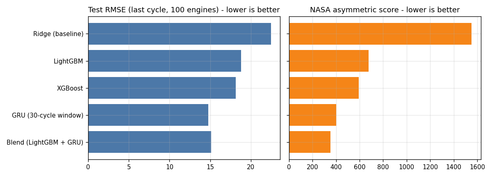
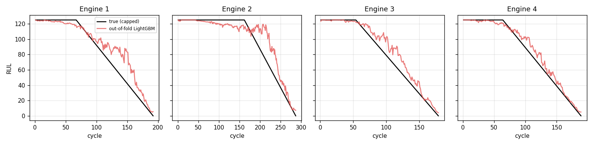
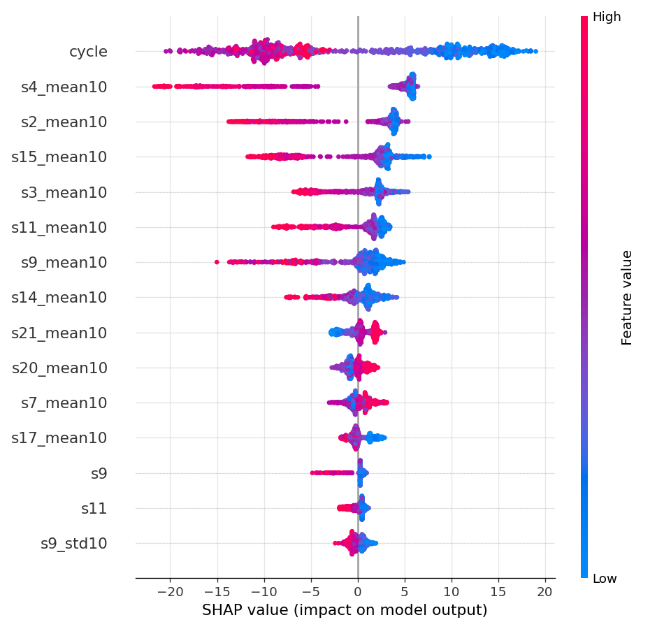

# Predictive Maintenance Platform for Industrial Machines

End-to-end machine-learning project: **when will a machine fail, and why?**
It predicts Remaining Useful Life (RUL) of turbofan engines, flags failures within the next 30 cycles with a
cost-sensitive threshold, detects anomalies in sensor streams, explains every alert with SHAP, estimates
maintenance cost savings, and serves everything through a **FastAPI** service and a **Streamlit** dashboard.

* Data: NASA **C-MAPSS FD001** (turbofan run-to-failure) + **AI4I 2020** (machine failures). Both are included in `data/raw/` (about 6 MB).
* Everything runs on CPU. A laptop with 8 GB RAM is plenty (measured numbers in [Resource usage](#resource-usage)).
* All numbers in this README were produced by `python -m pm.run_all` and are stored in `reports/metrics.json`.



## Results at a glance

**RUL regression** (official C-MAPSS FD001 test set, 100 engines, evaluated at each engine's last observed cycle; lower is better)

| Model | Val RMSE | Test RMSE | Test MAE | NASA score |
|---|---|---|---|---|
| Ridge (baseline) | 17.35 | 22.46 | 17.83 | 1552 |
| LightGBM (served model) | 14.91 | 18.80 | 13.92 | 675 |
| XGBoost | 14.84 | 18.14 | 13.40 | 593 |
| **GRU, 30-cycle window** | **11.20** | **14.78** | **11.03** | 401 |
| Blend (LightGBM + GRU) | n/a | 15.14 | 11.07 | **353** |

* The GRU is clearly better than boosted trees on this dataset (about 4 RMSE cycles). The sequence model uses the degradation trend directly; the trees see it only through hand-built rolling features.
* The NASA score punishes late predictions more than early ones; the blend wins on it, plausibly because averaging damps the worst late predictions (not tested separately).
* **Why the served model is LightGBM, not the GRU:** it gives exact per-sensor TreeSHAP explanations, needs no torch at serving time, and answers in about 34 ms. The dashboard also draws the GRU curve so you can see both. A production system would likely serve the blend and explain with the tree model.

**Failure classification: "fails within the next 30 cycles?"** (XGBoost, cost-optimal threshold 0.08; a missed failure costs $50k, a false alarm $5k)

| Test set | Positives | Precision | Recall | Missed / false alarms | Cost | PR-AUC | ROC-AUC |
|---|---|---|---|---|---|---|---|
| 100 engines, last cycle, cost-optimal threshold | 25 | 0.74 | 0.92 | 2 / 8 | **$140k** | 0.955 | 0.984 |
| same, default threshold 0.5 | 25 | 0.95 | 0.72 | 7 / 1 | $355k | 0.955 | 0.984 |
| all 13,096 test rows, cost-optimal threshold | 332 | 0.44 | 0.89 | 37 / 376 | $3.73M | 0.794 | 0.989 |

Choosing the threshold by business cost cut cost by about 60% versus the default 0.5, with the same model. The 100-engine test is small (25 positives), so treat these as indicative; the all-rows line is the more stable (but correlated) estimate.

**Anomaly detection** (trained on the first 50 cycles of healthy engines; alert = smoothed index above the healthy 99th percentile for 3 consecutive cycles)

| Detector | Val engines alerted | Median warning before failure | False alarms in healthy phase | Test AUC (vs. RUL ≤ 30) |
|---|---|---|---|---|
| Isolation Forest | 100% (20/20) | 54.5 cycles | 0 | 0.974 |
| Autoencoder | 40% (8/20) | 32.5 cycles | 0 | 0.799 |

The autoencoder is much weaker. Reason (failure analysis): engine degradation moves sensors *along* their strong correlations, so a 4-dimensional bottleneck reconstructs degraded readings almost as well as healthy ones. Isolation Forest does not rely on reconstruction and works better here. Both are kept so the comparison is visible.

**AI4I 2020 machine failure** (only 3.4% of rows fail; stratified 80/20 split, test = 2,000 rows, 68 failures)

| Strategy (validation PR-AUC) | Score |
|---|---|
| Logistic Regression (balanced) | 0.468 |
| Random Forest (balanced) | 0.852 |
| XGBoost, no imbalance handling | 0.869 |
| XGBoost, class weights | 0.860 |
| **XGBoost, random oversampling (selected)** | **0.871** |

Test: PR-AUC **0.897**, ROC-AUC 0.979, recall 0.88, precision 0.57 (60 of 68 failures caught, 46 false alarms). An unsupervised Isolation Forest reaches only 0.199 PR-AUC, which shows labels matter here. Differences between imbalance strategies are within noise, so the honest takeaway is "imbalance handling barely matters for gradient boosting at 3.4%; metric and threshold choice matter more". On this dataset the cost-optimal threshold chosen on validation (0.50) did not beat the default on test (cost $630k vs $625k). Both are far below predicting "never fails" ($3.4M).

**Leakage check:** the columns `TWF, HDF, PWF, OSF, RNF` *define* `Machine failure`. They are excluded. Including them lifts test PR-AUC from 0.897 to 0.977, a free "improvement" that would be useless in production.

**Simulated maintenance cost** (100 training engines, out-of-fold RUL predictions; in-service failure $50k, planned maintenance $8k, $40 per wasted cycle of life; all assumptions are editable in the dashboard)

| Policy | Avg cost / engine | In-service failures | Avg life wasted |
|---|---|---|---|
| Run to failure | $50,000 | 100 | 0 |
| Best fixed schedule (every 125 cycles) | $11,252 | 0 | 81 cycles |
| **Predictive (maintain when smoothed predicted RUL ≤ 15)** | **$8,428** | 0 | 11 cycles |

Savings: **83% vs run-to-failure, 25% vs the best fixed schedule** under these assumptions. Caveat: the trigger and the fixed interval are tuned on the same engines, and the best fixed interval (125) sits just below the shortest engine life (128), a very strong baseline, so the comparison is conservative against the predictive policy. The dollar figures are illustrative, not real plant data.

## What is in the project

| Capability | Where |
|---|---|
| RUL regression: Ridge, LightGBM, XGBoost, GRU, blend | `src/pm/train_rul.py`, `nets.py` |
| Failure classification + imbalance comparison + cost-sensitive threshold | `src/pm/train_failure.py`, `metrics.py` |
| Anomaly detection on sensor streams (Isolation Forest, autoencoder) | `src/pm/train_anomaly.py` |
| Explainability: TreeSHAP per prediction and per sensor, SHAP summary | `inference.py`, `run_all.py`, `reports/figures/` |
| Cost-savings simulation | `src/pm/cost.py` |
| Dashboard: health scores, RUL countdown, alert feed, what-if sliders, cost estimate | `src/pm/dashboard.py` |
| REST API with validation | `src/pm/api.py` |
| Tests (10) including a no-look-ahead feature test | `tests/` |
| Dockerfile, CI workflow | `Dockerfile`, `.github/workflows/ci.yml` |



## Quick start

Requires **Python 3.11+** (developed and tested on 3.12). Trained models are already included in `artifacts/`, so you can use the project without retraining.

```bash
python -m venv .venv && source .venv/bin/activate      # Windows: .venv\Scripts\activate
pip install -r requirements-serve.txt                  # dashboard + API only (no torch)
pip install --no-deps -e .

streamlit run src/pm/dashboard.py                      # dashboard on http://localhost:8501
uvicorn pm.api:app --port 8000                         # API docs on http://localhost:8000/docs
```

Optional (retrain everything, about 1 minute on CPU, results are deterministic with the fixed seed; GRU/autoencoder training needs torch):

```bash
pip install -r requirements.txt   # for a small CPU-only torch see the comment inside requirements.txt
python -m pm.run_all              # regenerates artifacts/ and reports/ (metrics.json, figures, CSVs)
pytest -q                         # 10 tests
```

Pinned versions in the requirements files are the exact versions the artifacts were trained and tested with. Model files are pickles, so keep the pins when using the shipped `artifacts/`.

## Dashboard

| Tab | What you get |
|---|---|
| Fleet overview | 100 engines with health score (0-100), alert counts, and an alert feed sorted by urgency showing RUL countdown, failure probability, anomaly index and the top sensors responsible |
| Engine detail & what-if | Replay an engine cycle by cycle; RUL (LightGBM and GRU vs. truth), anomaly index, SHAP bars for the current cycle, and sliders that shift sensor readings by ±3 standard deviations and re-score the engine |
| Cost savings | Editable cost assumptions, trigger slider, comparison against run-to-failure and a fixed schedule |
| Models & evaluation | All metric tables, figures, a live threshold slider showing precision / recall / cost |
| AI4I machine failure | Enter a machine's settings, get failure probability and drivers; threshold trade-off on the test set |

Alert levels use predicted RUL: **Critical** ≤ 15 cycles, **Warning** ≤ 30, **Watch** ≤ 60 (or failure probability above the cost-optimal threshold), otherwise **Healthy**. Health score = predicted RUL / 125 × 100.

## API

```bash
curl -s localhost:8000/health
curl -s -X POST localhost:8000/predict/machine-failure -H "Content-Type: application/json" \
  -d '{"type":"L","air_temp":300,"process_temp":309,"rot_speed":1300,"torque":68,"tool_wear":230}'
```

`POST /predict/rul` takes the engine's sensor history (oldest first; every row needs `cycle` and the 14 sensors
`s2, s3, s4, s7, s8, s9, s11, s12, s13, s14, s15, s17, s20, s21`) and scores the latest cycle. Example response for a
real test engine (true RUL at its last cycle: 7):

```json
{"engine_id":"engine-34","cycle":203,"predicted_rul_cycles":9.74,"health_score":7.8,"alert_level":"Critical",
 "failure_probability":0.989,"failure_within_horizon":true,"horizon_cycles":30,
 "anomaly_index":1.32,"anomaly_flag":true,"history_cycles_used":203,
 "top_drivers":[{"sensor":"s4","impact":-22.09},{"sensor":"s2","impact":-13.22},{"sensor":"s15","impact":-10.58},
                {"sensor":"s11","impact":-10.34},{"sensor":"cycle","impact":-6.43}]}
```

`impact` is the TreeSHAP contribution to predicted RUL in cycles (negative = shortens remaining life). Invalid input
(missing sensor, empty history, duplicate cycles, unknown machine type) returns HTTP 422. Docker: `docker build -t pm-api . && docker run -p 8000:8000 pm-api` (the Dockerfile is provided but was not built in the authoring environment).

## Method and design decisions

1. **Split by engine, never by row.** The 100 training engines are split 80/20 by engine (seed 42). The official 100-engine test set is used once, for final numbers. Test truth is the official `RUL_FD001.txt` (uncapped).
2. **RUL target is capped at 125 cycles** (standard C-MAPSS practice): early in life, degradation is invisible, so asking a model to tell 200 from 150 cycles is noise.
3. **Informative sensors only.** Seven FD001 sensors are constant and the three operating settings are uninformative (single operating condition), so 14 sensors are used.
4. **Features** per sensor: raw, 10-cycle rolling mean, 10-cycle rolling std, 5-cycle delta, plus the cycle count (age is known in production). A test (`test_features_have_no_lookahead`) proves that features at cycle *t* never use later cycles.
5. **GRU:** 30-cycle windows (early cycles padded with the first reading), 32 hidden units, early stopping on validation MSE. About 5k parameters, trains in well under a minute on CPU.
6. **Classifier threshold is chosen on the validation engines by minimising business cost** (missed failure $50k vs false alarm $5k), then applied unchanged to the test set.
7. **Anomaly detectors learn only healthy behaviour** (first 50 cycles of training engines). Scores are normalised so 1.0 = healthy 99th percentile, smoothed over 5 cycles, and an alert needs 3 consecutive exceedances.
8. **Cost simulation uses out-of-fold predictions** (5-fold GroupKFold by engine), so the model never scores an engine it trained on.

Top drivers (mean |SHAP|, validation engines): operating cycle, then sensors **s4, s2, s15, s9, s11**, which are the usual degradation-sensitive sensors in FD001.



## Limitations (please read)

* **FD001 only:** one operating condition and one fault mode, simulated data. FD002-FD004 (multiple conditions and faults) need per-condition normalisation and are not included. Results do not transfer automatically to real machines.
* **The served model is not the most accurate one** (see above). The dashboard shows the GRU alongside.
* **Small test set:** 100 engines (25 positives for the classifier). Metrics carry noticeable uncertainty; no confidence intervals are reported.
* **Cost figures are assumptions**, tuned on the same engines used to simulate them.
* **What-if sliders are a sensitivity probe, not a causal simulation** of what a repair or operating change would do.
* **Static test replay:** the dashboard replays recorded test engines; it does not ingest a live data stream. The API is unauthenticated and meant to run behind your own gateway.
* No data-drift monitoring or model retraining schedule is included.
* The autoencoder underperforms Isolation Forest (explained above); AI4I threshold tuning gave no test-set gain.

## Resource usage

Measured on a single-core sandbox with Python 3.12:

| Task | Time | Peak RAM |
|---|---|---|
| `python -m pm.run_all` (train + evaluate everything) | about 1 minute | about 1.0 GB |
| Dashboard | starts in a few seconds | about 290 MB |
| API | about 34 ms per `/predict/rul` request | about 245 MB |

No GPU is needed. Disk: about 9 MB for the whole repository.

## Repository layout

```
data/raw/            C-MAPSS FD001 + AI4I 2020 (see data/README.md for sources and licences)
src/pm/              config, data, features, metrics, nets, numpy_ae, train_*.py, cost, inference, api, dashboard, report, run_all
artifacts/           trained models + meta.json (thresholds, feature names, costs)
reports/             metrics.json, figures/, out-of-fold and test predictions (CSV)
tests/               pytest suite (10 tests)
```

## Status

All planned components are implemented, tested (10/10 tests pass, also with torch blocked to prove the serving path is torch-free), and run end to end. Results are reproducible with `python -m pm.run_all`.

## Licence and data credits

Code: MIT. C-MAPSS: NASA Prognostics Center of Excellence (Saxena & Goebel, 2008). AI4I 2020: S. Matzka, UCI Machine Learning Repository (CC BY 4.0).
